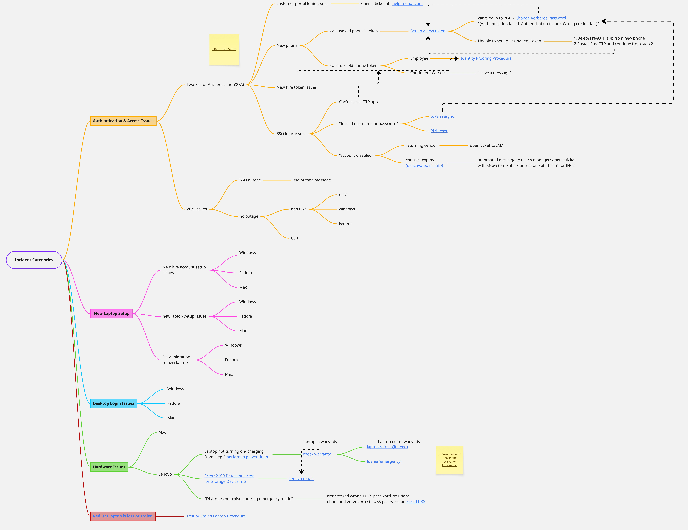

\# IT Support RAG Chatbot (Prototype)

An intelligent **Retrieval-Augmented Generation (RAG)** chatbot designed to improve efficiency for IT Support teams.  
This prototype focuses on resolving **hardware-related tickets** (Power, Charging, and Boot issues) by providing instant, protocol-driven guidance.

## 🚀 Problem & Solution

IT Support teams often handle a high volume of repetitive hardware issues.

- **Challenge:** Manually searching internal documentation slows resolution times and can result in inconsistent troubleshooting steps.
- **Solution:** Using RAG, the chatbot identifies the specific hardware issue and retrieves the exact internal protocol, guiding users or support agents through a standardized resolution process.

## 📊 Process Flow

The diagram below illustrates how the chatbot processes an incoming hardware ticket and selects the appropriate troubleshooting path:



## 🛠️ Tech Stack

- **Language:** Python 3  
- **LLM:** IBM Granite-3.3-8B (Instruct)  
- **Embeddings:** IBM Granite-125M-English  
- **Architecture:** Retrieval-Augmented Generation (RAG) using cosine similarity for document retrieval  

## ⚙️ Setup Instructions

### 1. Prerequisites

- Python 3 installed  
- Access to IBM Granite LLM API endpoints  

### 2. Configuration (Mandatory)

For security reasons, API keys are stored locally and excluded from version control.

1. Locate `config.json.example` in the project root.
2. Rename it to `config.json`.
3. Open the file and populate it with your API keys and endpoint URLs.

### 3. Running the Project

#### Step 1: Generate Document Embeddings

If you are running the project for the first time or have updated `documents.json`, generate the vector embeddings:

```bash
python generate_embeddings.py
```

#### Step 2: Start the Chatbot

Run the interactive QA script to begin troubleshooting hardware issues:

```bash
python rag_qa.py
```


---

### 📝 Roadmap & Future Scope

```markdown
## 📝 Roadmap & Future Scope

- [x] **Phase 1:** Hardware troubleshooting prototype (Power, Charging, Lenovo-specific issues)
- [ ] **Phase 2:** Integrate with Slack as an internal IT support bot
- [ ] **Phase 3:** Expand the knowledge base to include Software, VPN, and Network protocols
- [ ] **Phase 4:** Integrate with ServiceNow API for automated ticket creation and closure

